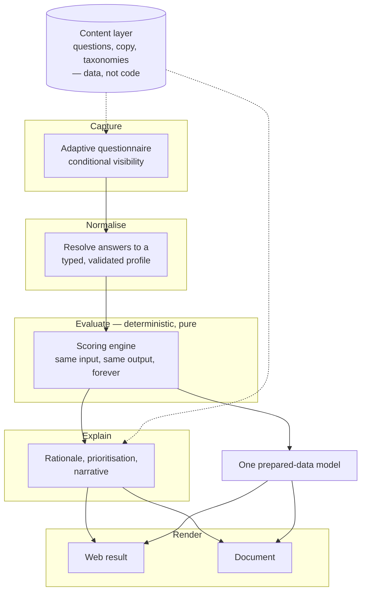

*Personal work. No confidential or employer-proprietary information. See [DISCLAIMER](../DISCLAIMER.md).*

# 3. A reference architecture for self-serve risk assessment tools

> **What this document is.** A pattern catalogue I advocate for building a questionnaire-driven
> assessment product, written as guidance for someone building one. It is **not** a description of any
> deployed system, and the boxes below do not correspond to any particular codebase. The value here is
> in the trade-offs, not the diagram — a generic diagram with no argument is filler.

## The shape

Five responsibilities, one sentence each:

| Layer | Responsibility |
|---|---|
| **Capture** | Ask the fewest questions that still separate meaningfully different organisations |
| **Normalise** | Turn answers into a typed profile, discarding anything the user was never actually asked |
| **Evaluate** | Produce a judgement — deterministically, reproducibly, with no I/O |
| **Explain** | Turn the judgement into prioritised, actionable language |
| **Render** | Emit every output surface from one prepared model |

## Pattern 1 — the evaluation layer is pure and deterministic

**The rule:** same inputs, same outputs, forever. No network calls, no clock, no randomness, no
language model.

**The alternative you are rejecting:** generating the assessment itself with an LLM. It is tempting —
it would handle free-text input, it would read fluently, and it would be quicker to build.

**The failure mode it avoids:** a customer re-runs the assessment with identical answers and gets a
different band. You now have no defensible product. A security leader's entire use for your output is
to present it and be challenged on it; "the model said so" fails that test immediately. Worse, you
cannot regression-test a non-deterministic judgement, so you lose the ability to tell whether a change
improved anything.

**Where the LLM does belong:** in *explanation*, not judgement. Phrasing a rationale, drafting
narrative, proposing wording — all additive, all discardable, none of it touching the score. Keep the
boundary architectural rather than conventional: if the evaluation module cannot make a network call,
nobody can accidentally put a model in the path.

**What it costs you:** free-text input becomes a separate, harder problem, and genuinely novel
situations get a generic answer. That is the right price.

## Pattern 2 — content is data, not code

Questions, option labels, explanatory copy, the taxonomies you map to, and the product or control
catalogue all live as editable data resolved at runtime, not as compiled literals.

**Layer the resolution:** a shipped default, an optional promoted override, and a live edit, with the
later layer winning. That gives you three useful properties — you can correct copy without a release,
you can promote a correction to become the new default, and you can always get back to the shipped
baseline.

**Why it matters more than it looks:** a standards-anchored product has a **standing currency
obligation**. Published frameworks move. Entries get renumbered, renamed, reordered; catalogues ship
monthly. If a taxonomy correction requires an engineer and a deploy, you will fall behind, and being
visibly out of date on the framework you cite is more damaging than any individual wrong answer,
because credibility is the entire product.

**The failure mode it introduces:** version skew. Two people now see different wording depending on
when they loaded the page, and your stored results reference content that has since changed. Contain
it by versioning the instrument (below) and by treating content edits as auditable events rather than
silent mutations.

## Pattern 3 — treat instrument versioning as schema migration

An assessment whose results must stay comparable across time is a migration problem wearing a content
hat. The moment you add a question, reword an option, or change how an answer maps, you have changed
what a stored result *means*.

Decide early, and write down, which of these you promise:

- **Results are comparable across versions.** Expensive. Every change needs a migration path and you
  will refuse changes you want to make.
- **Results are comparable within a version only.** Cheap and honest. Stamp every result with the
  instrument version and say plainly that a re-run after a revision is a new measurement.

I recommend the second, and recommend saying so in the product rather than in a footnote. The first
sounds better and quietly becomes a lie the third time someone reorders a question.

## Pattern 4 — decide your privacy posture architecturally, then describe it precisely

The strongest posture for a self-serve tool is **stateless by default**: assessment state lives in the
browser, nothing server-side, no account. It buys three things — no user records to protect, a
marginal cost per assessment of roughly a page load, and a trust claim you can make without
qualification.

**What changes the moment you let people save a session:** everything. You now hold answers, which
means you have a data-retention question, a deletion question, an encryption-at-rest question, an
access question, and a breach-notification question. These are all answerable. The failure is
answering them *and leaving the original "nothing leaves your browser" copy in place*.

**The rule I would enforce:** the privacy claim in the copy is a derived artefact of the architecture,
and it is reviewed every time persistence changes. If any part of the claim has become aspirational,
the copy changes before the next release — not after someone notices.

Related, and often missed: if a result is reachable by a shareable link or resume code, then *anyone
with the link* can open it. That is a design choice with a real trade-off, and it belongs in the
user-facing text, not only in the threat model.

## Pattern 5 — the report is a product surface, not an export

The document the customer downloads is not a serialisation of the web page. It is the artefact that
circulates inside their organisation, gets lifted into their board deck, and is read by people who
will never visit your product. Most of the perceived value lives there.

Two consequences:

**Generate every surface from one prepared model.** Web view and document should consume the same
prepared data, not re-derive it. The alternative — each renderer computing its own view — produces the
defect where the page and the document disagree, which is the single most credibility-destroying bug
this class of product has. If the two cannot diverge by construction, they will not.

**Put document generation behind a build gate.** If the thing you hand the customer is a file, then
producing that file is not downstream of the work — it is the work. Emit a real artefact on every
change and look at it with your eyes. Layout faults in generated documents slip past type checkers
and unit tests without resistance; the only reliable detector is a rendered page.

## Pattern 6 — testing a system whose output is an opinion

Conventional tests tell you the engine still does what it did yesterday. For a scoring product, that
is necessary and nowhere near sufficient — a snapshot suite will happily preserve a wrong answer
forever. [Document 5](05-validating-a-scoring-model.md) covers the method in full; architecturally, you
need four distinct categories:

1. **Invariants** — properties that must hold for all inputs. Bounds, monotonicity, and the
   relationships between composite values and their parts.
2. **Golden cases** — authored organisations with an expected outcome written by a human *before* the
   engine was run.
3. **Twins** — two cases differing in exactly one respect, asserting only the *direction* of the
   difference. These are the sharpest tests available, because ordering and level are separate
   properties: a wrong level is a tuning fault and moving a boundary repairs it, while a wrong
   ordering is a reasoning fault that no boundary will ever repair.
4. **Completeness checks** — every item in the instrument is reachable, every mapping target exists,
   nothing is orphaned.

Keep the evaluation harness out of the application's dependency graph entirely. It is an instrument
for assessing the product, not part of it.

## Pattern 7 — enforce module boundaries mechanically

Layer boundaries that exist only by convention stop existing under deadline. Enforce them with
tooling, so that the evaluation layer importing a rendering helper is a build failure rather than a
code-review conversation. This is cheap to set up at the start and effectively impossible to retrofit.

## Known failure modes

Things I would watch for in any product of this shape:

- **Duplicated truth.** The same fact derived in two places will drift, and the drift surfaces as the
  page and the document disagreeing. Derive, never store a second copy — see
  [D7 in the decision log](06-decision-log.md).
- **Silent defaults.** When an unanswered question is given a default, that default is a *modelling
  assumption* and must be disclosed to the user, not buried. Show a completeness indicator.
- **Presentation drift from logic.** If a displayed band and the underlying judgement are computed
  from separate sources, they will eventually disagree. Derive the presentation from the logic.
- **Scope creep into scanning.** Every review will produce someone asking you to connect to something.
  The answer is a different product, and saying so early protects both.

---

**Next:** [4. Designing the instrument](04-designing-the-instrument.md)
